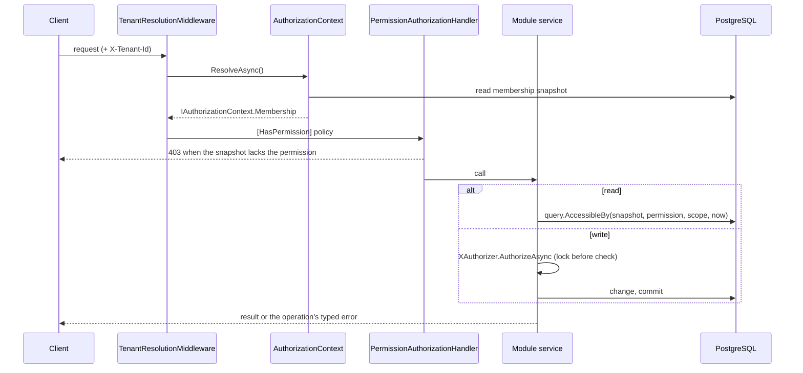
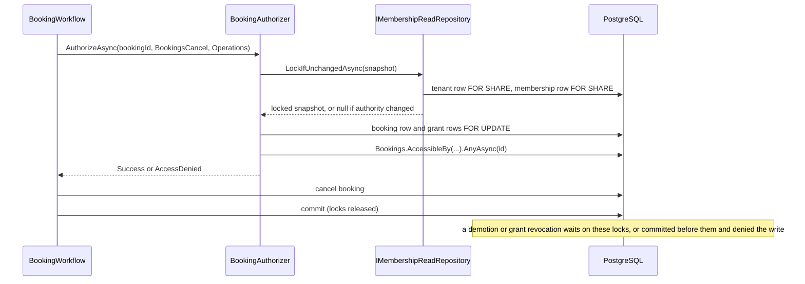

# Concertable.B2B — Architecture

> Cross-service design rationale and decision history: the `microservices-architecture` skill
> Internal module rules: the `dotnet-standards:module-structure` and `dotnet:module-structure` skills
> Outstanding gaps: [`TECH_DEBT.md`](./TECH_DEBT.md)

---

## Bounded context

B2B owns the venue/artist side of Concertable: opportunities, applications, bookings, contracts, concert workflow, settlement, and manager/admin profiles. Opportunity, Application, Booking and Concert are separate stage aggregates in separate modules; Concert is the final stage, not the entire recruitment/booking lifecycle. It consumes Booking's immutable `ConfirmedBooking` handoff, rather than loading live Application/Opportunity terms. Product direction and the target direct-invitation route are routed from [`AGENTS.md`](./AGENTS.md#product-direction--configurable-work-within-fixed-lifecycle-routes); the current lifecycle is owned by [`api/src/Modules/Concert/AGENTS.md`](./api/src/Modules/Concert/AGENTS.md). B2B does **not** own ticket buyers, customer reviews, or browse/search — those belong to Customer and Search respectively.

---

## Host topology

| Project | Kind | Purpose |
|---|---|---|
| `Concertable.B2B.Web` | ASP.NET Core HTTP host | All controllers + ASB event consumers (in-process). Composition root. |
| `Concertable.B2B.Workers` | Azure Functions isolated | Background jobs. Currently: `ConcertFinishedFunction` (hourly timer). Uses **in-memory transport** — see TECH_DEBT. |
| `Concertable.B2B.DataAccess` | Shared csproj | Shared data-access primitives: tenant query filters, the per-stance DbContext base classes, and repositories. |
| `Concertable.B2B.AppHost` | Aspire AppHost | Local-dev orchestrator only. |

**Database:** `B2BDb` (PostgreSQL). Artist, Venue, and Concert each use a tenant-bound tracked/write
`<Module>DbContext` plus a tenant-independent read-only `<Module>ReadDbContext`. Conversations also has
`ConversationsPrivilegedDbContext` for tenant-independent moderation writes
and `ConversationsReadDbContext` for the unfiltered subject-access read. Privacy coordinates read-only subject exports through module facades and owns no database schema.

---

## Modules

Modules live under `api/src/Modules/`. Each follows the `Concertable.B2B.<Module>.*` naming convention.

| Module | Canonical entities | Projects |
|---|---|---|
| **Artist** | `ArtistEntity` | Api, Application, Contracts, Domain, Infrastructure, IntegrationTests |
| **Opportunity** | `OpportunityEntity` (recruitment listing, state and `DealId`) | Api, Application, Contracts, Domain, Infrastructure, IntegrationTests |
| **Application** | `ApplicationEntity` (application decision and accepted snapshot handoff) | Api, Application, Contracts, Domain, Infrastructure, IntegrationTests, UnitTests |
| **Booking** | `BookingEntity` (confirmation and pre-Concert cancellation), `ContractEntity` (accepted terms/signatures) | Api, Application, Contracts, Domain, Infrastructure, IntegrationTests, UnitTests |
| **Concert** | `ConcertEntity` (live concert, publication, cancellation and settlement; frozen booking snapshot), `InvoiceEntity` | Api, Application, Contracts, Domain, Infrastructure, IntegrationTests, UnitTests |
| **Deal** | `DealEntity` (current TPT: `FlatFeeDealEntity`, `DoorSplitDealEntity`, `VersusDealEntity`, `VenueHireDealEntity`) | Api, Application, Contracts, Domain, Infrastructure, IntegrationTests, UnitTests |
| **Conversations** | `MessageEntity`, `ParticipantProfile` (local sender-display projection) | Api, Application, Contracts, Domain, Infrastructure |
| **Tenant** | `TenantEntity` (business account, membership boundary, legal/VAT/Stripe identity, settlement payee) | Api, Application, Contracts, Domain, Infrastructure, IntegrationTests, UnitTests |
| **User** | `UserEntity` (flat) + standalone `AdminProfileEntity` — no TPH, no manager-profile subtypes | Api, Application, Contracts, Domain, Infrastructure, IntegrationTests |
| **Venue** | `VenueEntity`, `VenueImageEntity`, `PayoutAccountEntity` | Api, Application, Contracts, Domain, Infrastructure, IntegrationTests |

Cross-module calls go through `IXModule` facades in `Concertable.B2B.<Module>.Contracts` only. No direct entity reach-in between modules.

`Tenant` is the canonical backend concept. In the current one-to-one model it is both the isolation boundary and the business/legal account; there is no separate organisation aggregate or identifier. Artist and Venue are tenant-owned marketplace profiles. Organisation wording belongs only at presentation boundaries.

---

## Integration events

All event types implement `IIntegrationEvent` from `Concertable.Messaging.Contracts`. Transport: Azure Service Bus (`concertable-b2b` service name, `event-` topic prefix). Wired in `Concertable.B2B.Web/Program.cs`.

### Published

| Event | Defined in | When raised |
|---|---|---|
| `ArtistChangedEvent` | `Concertable.B2B.Artist.Contracts.Events` | Artist profile updated |
| `ArtistRatingUpdatedEvent` | `Concertable.B2B.Artist.Contracts.Events` | Rating projection updated |
| `VenueChangedEvent` | `Concertable.B2B.Venue.Contracts.Events` | Venue profile updated |
| `VenueRatingUpdatedEvent` | `Concertable.B2B.Venue.Contracts.Events` | Rating projection updated |
| `ConcertChangedEvent` | `Concertable.B2B.Concert.Contracts.Events` | Concert edited / stage changed |
| `ConcertPostedEvent` | `Concertable.B2B.Concert.Contracts.Events` | Concert moves to Posted stage |
| `ConcertRatingUpdatedEvent` | `Concertable.B2B.Concert.Contracts.Events` | Rating projection updated |

The B2B host also dispatches published integration events to registered local handlers. Conversations consumes `ArtistChangedEvent` and `VenueChangedEvent` locally to maintain its `ParticipantProfile` projection keyed by `TenantId`; sender rendering never reaches into Artist or Venue storage synchronously.

### Consumed

| Event | Source | Handler(s) |
|---|---|---|
| `CredentialRegisteredEvent` | Auth | `CredentialRegisteredHandler` (User module — creates the role-agnostic user projection and the surviving admin profile) |
| `CustomerReviewSubmittedEvent` | Customer | `ArtistReviewProjectionHandler`, `VenueReviewProjectionHandler`, `ConcertReviewProjectionHandler` |
| `PaymentSucceededEvent` | Payment | `SettlementPaymentProcessor`, `EscrowPaymentProcessor`, `VerifyPaymentProcessor`, `TicketSaleProcessor` |
| `PaymentFailedEvent` | Payment | `BookingPaymentFailedProcessor`, `VerifyPaymentFailedProcessor` |

All consumed events use `InboxMessageEntity` deduplication keyed by `(MessageId, ConsumerName)`.

---

## Sync calls out

| Target | Client | Usage |
|---|---|---|
| `Concertable.Payment` | `Concertable.Payment.Client` | Create payment intents, transfers, refunds, payout account ops |
| `Concertable.Auth` | JWT Bearer middleware | Token validation; `client_credentials` for service-to-service tokens |

No sync calls to Customer or Search. B2B and Customer communicate **exclusively via bus events**.

---

## Authentication

- JWT Bearer, audience `concertable.b2b.api`
- `client_credentials` client: `concertable-b2b`, scope `payment:write`
- **No role claims in tokens.** B2B tokens are identity-only (`sub` + `email`); acting authority is the request-scoped active tenant membership (`X-Tenant-Id` → the member's roles), never a token claim. See [Authorization](#authorization).

---

## Authorization

B2B decides every permission in-process, from data it owns. A request carries one immutable statement of
who is acting; each module owns the rule for the resources it stores; and a write locks the rows its
decision reads before it decides, so a concurrent role or grant change cannot slip between check and
commit.

### Request authority

`TenantResolutionMiddleware` runs after authentication and asks `AuthorizationContext`
(`Authorization.Infrastructure`) to resolve the caller's membership in the active tenant: the
`X-Tenant-Id` header, or the caller's only membership when there is no header. The result is a
`MembershipSnapshot`, exposed for the rest of the request as `IAuthorizationContext.Membership`:

| Snapshot member | Meaning |
|---|---|
| `MembershipId`, `TenantId`, `UserId` | Who is acting, in which tenant |
| `PermissionVersion` | Bumped by the membership's role changes |
| `RolePolicyVersion` | The tenant's role-definition version, bumped when a role's permissions change |
| `Permissions` | `EffectivePermissions`: each held `TenantPermission` with its `ResourceAccess`: `Assigned` (only resources the member is assigned to) or `All` (everything the tenant can see) |

The snapshot never changes during the request and compares by value. `HasPermission` and
`Permissions[permission]` answer tenant-level questions in memory; anything that writes re-checks the snapshot under lock (below).

### Endpoint gate

`[HasPermission(TenantPermission.XName)]` names a policy that `PermissionPolicyProvider` builds and
`PermissionAuthorizationHandler` satisfies when the snapshot holds the permission at any access. It is a
coarse filter that keeps callers without the permission out of the service; it does not decide access to
a particular resource.

### Per-module rules

Each module that stores a shareable resource owns its rule as an `IQueryable<X>.AccessibleBy(actor,
permission, scope, at)` extension in its `Infrastructure/Data`: Application, Booking and Contract,
Concert and Invoice, Conversation. The rule reads the permission's catalog binding for that resource and
scope, applies its principal policy (for example, the venue or artist tenant of a booking) and requires a
live grant for each scope the binding names. Grant liveness and access are one expression,
`ResourceAccessGrant<TScope>.IsLiveFor`.

Reads compose `AccessibleBy` into the query, so lists and single reads share the rule. Writes go
through the module's `XAuthorizer.AuthorizeAsync(id, permission, scope)`, which returns
`UnitResult<AccessDenied>`; the service maps a denial to its own error. Tenant administration uses
`TenantAuthorizer.AuthorizeAsync` / `AuthorizeOwnerAsync` for tenant-level permissions.

```csharp
if ((await authorizer.AuthorizeAsync(
        bookingId, TenantPermission.BookingsCancel, BookingAccessScope.Operations, ct)).IsFailure)
    return new CancelBookingError.NotPermitted();
```

### Lock before check

`XAuthorizer.AuthorizeAsync` runs inside the operation's unit of work and decides only after taking the
locks its decision depends on:

1. `IMembershipReadRepository.LockIfUnchangedAsync(snapshot)` locks the tenant and membership rows
   `FOR SHARE` and returns the current snapshot, or `null` when the membership, its versions, its
   permissions or the installed catalog revision differ from the request's snapshot.
2. The resource row and its grant rows are locked `FOR UPDATE`.
3. `AccessibleBy(...).AnyAsync(...)` decides against the locked rows.

Role and membership changes take the tenant row `FOR UPDATE` and grant changes take the resource row
`FOR UPDATE`, so they conflict with these locks. A concurrent change therefore either commits first and
the write is denied, or waits until the write commits. A denial returns a failed result and the unit of
work rolls back. The Booking and Concert integration race tests prove both orderings; the
[transaction pattern](patterns/EF_CORE_TRANSACTIONS.md) owns the unit of work itself.

### Generated catalog

Each module declares its permissions in `api/src/Modules/<Module>/authorization.json`: label, resource
bindings (resource, scope, principal policy, required grant scopes), assignable access and the access
each system preset role holds. `scripts/generate-authorization.py` validates them and writes
`TenantPermission`, `AuthorizationCatalog` (with the `AuthorizationResource` enum and a content-hash
`Revision`) and the frontend `TenantPermission` union. CI runs it with `--check`, so the committed output
cannot drift. The revision is seeded into the database; while the installed revision differs from the
code's, `LockIfUnchangedAsync` returns `null` and authorized writes fail closed.

### Request flow



### Write lock sequence



---

## Internal architecture

B2B is a modular monolith *inside* the service. The `dotnet-standards:module-structure` and `dotnet:module-structure` skills apply verbatim:

- Cross-module calls: `IXModule` facade only (in `<Module>.Contracts`)
- Per-module `XDbContext` with its own schema; all point at `B2BDb`
- Intra-service events: in-process `IEventRaiser` + `XChangedDomainEvent` — no bus involvement
- Module-owned `IEntityTypeConfiguration<T>` in `<Module>.Infrastructure/Data/Configurations/`
- Per-module `IDevSeeder` / `ITestSeeder`
- `InternalsVisibleTo` chains; module Application interfaces stay `internal`

The bus (`AddAzureServiceBusTransport`) is for **cross-service** events only. Intra-B2B flows that currently round-trip ASB are flagged in TECH_DEBT.

---

## Tech stack

.NET 10 · EF Core + Npgsql/PostgreSQL · Azure Service Bus (ASB emulator in dev) · `Concertable.Messaging` (Outbox/Inbox/Transport) · NetTopologySuite (geometry) · Duende IdentityServer (Auth service) · Aspire (`Concertable.ServiceDefaults`) · SignalR (real-time notifications) · `Concertable.Shared.{Blob,Email,Geocoding,Imaging,Pdf}`

---

## What is NOT in this service

| Concern | Lives in |
|---|---|
| Ticket sales, ticket entities | `Concertable.Customer` |
| Customer reviews (`ReviewEntity`) | `Concertable.Customer` |
| Customer profile / preferences | `Concertable.Customer` |
| Browse / autocomplete / search reads | `Concertable.Search` |
| Stripe API keys, webhook receiver | `Concertable.Payment` |
| Identity authority (`sub`, password hash, email verification) | `Concertable.Auth` |
